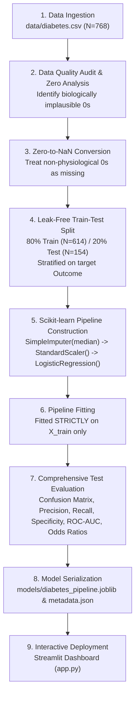

# Healthcare Diabetes Risk Classification Pipeline
### MSc in Health Informatics and Analytics | Machine Learning Workflow Project

[](https://www.python.org/)
[](https://scikit-learn.org/)
[](https://streamlit.io/)
[]()

> **⚠️ Academic & Health Informatics Regulatory Notice:**  
> This project is designed strictly for educational training, academic assessment, and health informatics benchmarking. It is **not clinically validated** or cleared by regulatory bodies (e.g., US FDA SaMD, EU MDR). It does not substitute for certified clinical diagnostic judgment and must **never** be used for autonomous medical diagnosis or patient treatment decisions.

---

## 1. Executive Summary & Problem Definition

### Clinical Background
Diabetes mellitus is a chronic metabolic disorder marked by persistent hyperglycemia due to defective insulin secretion, defective insulin action, or both. Undiagnosed or unmanaged diabetes leads to irreversible microvascular complications (diabetic retinopathy, nephropathy, and peripheral neuropathy) and macrovascular diseases (coronary artery disease, myocardial infarction, and ischemic stroke).

Early risk screening enables targeted lifestyle modifications (caloric restriction, physical activity) and preventive pharmacotherapy, dramatically curbing disease progression.

### Machine Learning Task
- **Paradigm:** Supervised Binary Classification.
- **Goal:** Predict the likelihood of diabetes in adult female patients based on demographic factors, physiological vitals, and laboratory measurements.
- **Target Variable (`Outcome`):**
  - `0`: Negative (Non-Diabetic / Low Risk)
  - `1`: Positive (Diabetic / Elevated Risk)
- **Input Feature Vector ($X \in \mathbb{R}^8$):** `Pregnancies`, `Glucose`, `BloodPressure`, `SkinThickness`, `Insulin`, `BMI`, `DiabetesPedigreeFunction`, and `Age`.

---

## 2. Technology Stack

| Component | Library / Framework | Purpose |
| :--- | :--- | :--- |
| **Programming Language** | Python 3.10+ | Core language environment |
| **Data Manipulation** | Pandas & NumPy | Ingestion, data hygiene, matrix transformations |
| **Statistical Visualizations** | Matplotlib & Seaborn | Class balance, feature distributions, heatmaps |
| **Machine Learning Engine** | Scikit-learn (`Pipeline`) | Imputation, feature standardization, Logistic Regression |
| **Artifact Serialization** | Joblib & JSON | Persisting fitted pipelines and evaluation metadata |
| **Clinical Dashboard** | Streamlit | Web-based Clinical Decision Support System (CDSS) interface |

---

## 3. End-to-End Machine Learning Workflow

This project adheres strictly to clinical machine learning best practices:



### Stage 1: Data Ingestion & Quality Audit
- Uses the canonical National Institute of Diabetes and Digestive and Kidney Diseases (NIDDK) Pima benchmark dataset.
- Verifies absence of duplicated records and confirms proper numerical schemas.

### Stage 2: Physiological Zero Handling (Health Informatics Nuance)
In standard data science, zero (`0`) is treated as a numerical value. In human physiology, several zero entries are non-viable:
- **`Glucose = 0`**: Incompatible with conscious life (severe fatal hypoglycemia).
- **`BloodPressure = 0`**: Represents lack of systemic arterial pressure (cardiac arrest).
- **`SkinThickness = 0`**: Anatomically impossible absence of subcutaneous tissue.
- **`Insulin = 0`**: Biologically abnormal in non-diabetic living patients during oral tolerance testing.
- **`BMI = 0`**: Physically impossible.

*Action:* These zeroes are mapped to `np.nan` so statistical imputation can estimate realistic biological values. In contrast, `Pregnancies = 0` is retained as a valid biological integer (nulliparous women).

### Stage 3: Strict Avoidance of Data Leakage
> **Critical Exam Principle:** Never compute imputation statistics (medians) or normalization parameters ($\mu, \sigma$) across the entire dataset prior to splitting!  
> Doing so allows information from the hold-out test set to contaminate the training procedure, yielding over-optimistic performance estimates.

*Solution:* We partition into $X_{train}$ and $X_{test}$ **before** fitting. The `SimpleImputer` and `StandardScaler` are fitted exclusively on $X_{train}$, and merely applied to $X_{test}$ and runtime inputs.

### Stage 4: Pipeline Construction & Model Training
We encapsulate preprocessing and modeling inside a Scikit-learn `Pipeline`:
1. **`SimpleImputer(strategy='median')`**: Replaces `NaN` with median values. Median is selected because skewed laboratory features (e.g., Insulin) make the mean clinically unrepresentative.
2. **`StandardScaler()`**: Transforms features to $Z$-scores ($\mu=0, \sigma=1$). This ensures gradient descent convergence and allows direct comparison of logistic regression coefficients.
3. **`LogisticRegression(random_state=42, max_iter=1000)`**: A generalized linear model producing calibrated probability estimates $P(Y=1|X) = \frac{1}{1 + e^{-(\beta_0 + \mathbf{w}^T \mathbf{x})}}$.

---

## 4. Model Evaluation & Clinical Interpretation

### Hold-Out Test Set Metrics ($N = 154$, 20% Stratified)

| Metric | Test Set Score | Clinical Meaning |
| :--- | :--- | :--- |
| **Accuracy** | **70.8%** | Overall fraction of correct classifications |
| **Sensitivity (Recall)** | **50.0%** | Proportion of true diabetic individuals detected ($TP / (TP + FN)$) |
| **Specificity** | **82.0%** | Proportion of healthy individuals correctly cleared ($TN / (TN + FP)$) |
| **Precision (PPV)** | **60.0%** | Likelihood that a flagged patient is truly diabetic ($TP / (TP + FP)$) |
| **F1-Score** | **0.546** | Harmonic mean balancing Precision and Recall |
| **ROC-AUC** | **0.813** | Discrimination capacity across all decision thresholds |
| **PR-AUC** | **0.673** | Precision-Recall curve area (robust to class imbalance) |

### Clinical Confusion Matrix
```
                         PREDICTED NEGATIVE (0)     PREDICTED POSITIVE (1)
ACTUAL NEGATIVE (0)           TN = 82                    FP = 18
ACTUAL POSITIVE (1)           FN = 27                    TP = 27
```

### Why Accuracy Alone Is Misleading in Healthcare
1. **Class Imbalance:** In this cohort, **64.9%** of patients are negative. A naive "dummy classifier" that classifies every patient as healthy would achieve **64.9% accuracy**, yet have **0% Recall** — missing 100% of sick patients!
2. **Asymmetric Error Costs:**
   - **False Negative (27 patients):** A diabetic patient is told they are healthy. Treatment is delayed, leading to preventable renal failure, neuropathy, and retinopathy. **Catastrophic clinical cost.**
   - **False Positive (18 patients):** A healthy individual is flagged as high risk. They receive a low-cost confirmatory blood test (HbA1c/OGTT) and experience minor anxiety. **Low physical risk.**
3. **Conclusion:** In health informatics, **Recall (Sensitivity)** and **ROC-AUC** are substantially more important than raw Accuracy.

### Model Interpretability via Odds Ratios ($OR = e^\beta$)
Because features are standardized, the exponentiated coefficients show the multiplicative shift in diabetes odds per standard deviation increase:
- **`Glucose` ($OR = 3.26$):** Each standard deviation increase in plasma glucose multiplies the odds of diabetes by **3.26x**.
- **`BMI` ($OR = 1.99$):** Each standard deviation increase in BMI multiplies the odds of diabetes by **1.99x**.
- **`Pregnancies` ($OR = 1.46$):** Higher parity associates with a **1.46x** odds increase.
- **`DiabetesPedigreeFunction` ($OR = 1.26$):** Strong familial genetic history increases odds by **1.26x**.

---

## 5. Repository Structure

```
healthcare-diabetes-pipeline/
├── data/
│   ├── diabetes.csv              # Teaching benchmark dataset (N=768)
│   └── README.md                 # Dataset provenance, dictionary, and zero-handling notes
├── models/
│   ├── diabetes_pipeline.joblib  # Fitted Scikit-learn Pipeline (Imputer + Scaler + Model)
│   └── model_metadata.json       # Serialized evaluation metrics, confusion matrix, odds ratios
├── reports/
│   └── figures/                  # High-resolution clinical figures generated during training
│       ├── class_distribution.png
│       ├── feature_distributions.png
│       ├── correlation_heatmap.png
│       ├── confusion_matrix.png
│       └── roc_pr_curves.png
├── app.py                        # Interactive Streamlit Clinical Decision Support Dashboard
├── train_model.py                # End-to-end training, evaluation, and artifact generation script
├── requirements.txt              # Production dependency specifications
├── .gitignore                    # Git rules for environments, caches, and system files
└── README.md                     # Comprehensive academic project documentation
```

---

## 6. Setup and Step-by-Step Execution Guide

Follow these commands in your Windows PowerShell terminal:

### Step 1: Open Terminal in Project Folder
Verify you are inside the project root:
```powershell
cd "c:\Users\KRIPA T\OneDrive\Desktop\helthcare ml pipeline"
```

### Step 2: (Optional) Create & Activate a Virtual Environment
```powershell
python -m venv venv
.\venv\Scripts\Activate.ps1
```

### Step 3: Install Required Dependencies
```powershell
pip install -r requirements.txt
```

### Step 4: Run the Machine Learning Training Pipeline
This script audits the data, creates visual figures, performs stratified splitting, fits the pipeline, evaluates hold-out performance, and serializes the artifacts:
```powershell
python train_model.py
```
*Expected Output:* You will observe the biological zero audit, class distribution metrics, test set evaluation report, and confirmation that `models/diabetes_pipeline.joblib` and `models/model_metadata.json` have been generated.

### Step 5: Launch the Streamlit Clinical Web Dashboard
```powershell
streamlit run app.py
```
*Access:* Your default web browser will open `http://localhost:8501`.

---

## 7. Clinical AI Governance, Monitoring & Limitations

For an MSc student presenting this work to academic and clinical examiners, understanding model limitations and governance is paramount:

### 1. Demographic Homogeneity & Representation Bias
The teaching dataset originates exclusively from adult females of Pima Indian heritage. It cannot be assumed to generalize accurately to pediatric populations, adult males, or other racial/ethnic demographics without substantial retraining and calibration.

### 2. Missing Contemporary Clinical Biomarkers
Modern diabetes diagnosis utilizes **Hemoglobin A1c (HbA1c)**, which reflects average glycemia over the preceding 90 days. The benchmark dataset utilizes older 2-hour oral glucose tolerance testing and lacks HbA1c, lipid profiles (HDL, LDL, triglycerides), and renal markers (creatinine, eGFR).

### 3. Model Drift in Clinical Production
- **Covariate Shift (Data Drift):** $P(X)$ changes over time. Occurs if the hospital clinic population shifts toward older demographics, or if laboratory assay machines are recalibrated.
- **Concept Drift:** $P(Y|X)$ changes over time. Occurs if clinical practice guidelines alter the diagnostic definition of diabetes (e.g., ADA adjusting fasting plasma glucose cutoffs).
- **Informatics Solution:** Production healthcare ML systems must monitor metrics like the Population Stability Index (PSI) and Wasserstein Distance to trigger model recalibration before clinical degradation occurs.

### 4. Mandatory External Multi-Center Validation
A high test score on a single internal dataset never guarantees real-world clinical safety. Prior to deployment in any Clinical Decision Support System (CDSS), prospective validation across multiple independent hospitals, diverse socioeconomic groups, and varied clinical protocols is mandatory under regulatory frameworks (e.g., FDA Good Machine Learning Practice, EU Artificial Intelligence Act).
